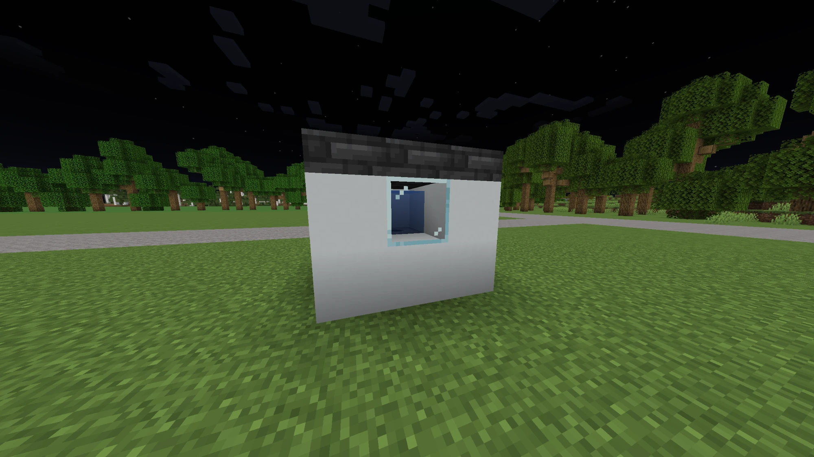

# Getting started

This page takes you from installing EZvac to a room that heats and cools on
its own. It takes about five minutes in game.

## Install

You need Paper 1.21.1 or a Paper fork such as Purpur, on Java 21.

1. Put `EzVac-ALPHA-3.0.jar` in your server's `plugins` folder.
2. Start the server. EZvac writes `plugins/EZvac/config.yml` and logs a line
   such as `EZvac enabled: 0 thermostat(s), ...`.
3. In game, `/hvac help` lists the commands you can use.

Building things needs `ezvac.admin` (operators have it). Players need only
`ezvac.use`, which everyone has by default. See [Commands](commands.md).

## Your first system

A **system** is a thermostat, the equipment that heats or cools, and the vents
that blow the air into a room. You put them together with the **link tool**:
select the thermostat, then click everything that belongs to it.

### 1. A room

Any closed room works. Doors and trapdoors pass air when they are open and stop
it when they are closed, and carpets let air through, so a carpeted floor is
still part of the room. See [Vents and airflow](airflow.md).

### 2. The heat pump

A heat pump is a **dispenser** in a closed casing. While it runs it puts a
block of water in front of itself, so that cell has to be boxed in on every
side or it spills. Glass makes a good window.

```text
 side view, looking at the dispenser's front:

 [casing][casing][casing]
 [casing][ water][casing]    <- appears while it runs
 [casing][casing][casing]
 (the dispenser sits behind the water cell, facing into it)
```



The casing doesn't have to touch the room: the room is reached through vents,
linked in step 4. Look at the dispenser and run:

```text
/hvac create heatpump
```

More on every kind of equipment, and on the casing, in
[Equipment and thermostats](equipment.md).

### 3. The thermostat

Put a sign anywhere you like, look at it, and run:

```text
/hvac create thermostat Home 72
```

`Home` is the thermostat's name, and `72` the target (72 °F if you leave it
out). Names don't have to be unique: every house on the server can have a
Home. Temperatures are in °F unless the server uses Celsius (`units: C`);
`72F` or `22C` always works. The sign shows the room temperature, what the
system is doing, the target and how long until it gets there:

```text
EZvac | Home
68.4 F | HEAT
Set 72.0 F | 100%
ETA 0:52 | 1/1
```

### 4. Link it together

Vents are **iron trapdoors** in the room. Get the link tool:

```text
/hvac link-tool
```

1. Right-click the thermostat sign to select it.
2. Right-click the heat pump's dispenser to link it.
3. Right-click each iron trapdoor in the room to link it as a vent.
4. Sneak-right-click anything to unlink it again.

If you're holding the tool with a thermostat selected when you create
equipment or a sign, it's linked straight away.

Air spreads from each vent through the room: full strength for 15 blocks of
airflow, fading out by 30.

### 5. Check it

- Stand in the room and run `/hvac temperature` to read the temperature,
  humidity and which system reaches you.
- `/hvac hud` keeps the climate where you stand on screen. See
  [HUD and placeholders](hud-and-placeholders.md).
- To change the target, right-click the thermostat sign and use its menu, or
  look at it and run `/hvac thermostat set 70`.
- To switch the whole system off, sneak-right-click the thermostat sign; do it
  again to switch it back on.

## Next

- Cooling only, or a furnace for heat: [Equipment and thermostats](equipment.md)
- Heating or cooling a pool: [Vents and airflow](airflow.md#water-systems-pools)
- Drying a basement or adding moisture: [Dehumidifiers and humidifiers](dehumidifiers-and-humidifiers.md)
- Thermometers and remote sensors: [Sensors and readings](sensors.md)
- How weather and humidity work: [Climate](climate.md)
